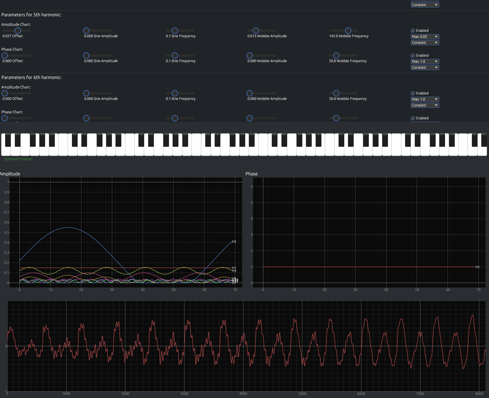

# LeSynth - Fourier

A Fourier (additive) synthesizer plugin for VST3 and CLAP, built in Rust using the nih-plug framework. LeSynth - Fourier generates harmonic sounds through Fourier synthesis with customizable amplitude and phase curves for each harmonic. It can also turn a real recording into an editable harmonic grid. Version 1.3.0 runs on Linux, Windows and macOS.



Demo MP4 video file can be found in the Assets section of [releases page](https://github.com/hlavnjak/lesynth-fourier/releases/)

## Features

- **256 Harmonics**: Complete control over amplitude and phase for each harmonic with customizable time-varying curves
- **Advanced Curve System & Time-Domain Modulation**: Modify amplitude/time and phase/time curves for each harmonic across buckets/periods using constant, sine and Nested Fourier curve types, enhanced with Wobble sine component for complex modulation
- **Adjustable Bucket Count**: Set how many buckets (periods) the grid has; resizing resamples the grid, keeping your edits
- **Analysis Mode**: Turn a recording into a harmonic grid — one bucket per pitch period, with each harmonic's amplitude and absolute phase. The transform is exactly invertible, so the unedited grid plays the source back. Toggle individual harmonics, or override any of them with your own curve. Audio comes in through the [ReSynth Studio](https://github.com/hlavnjak/resynth-studio) DAW, which embeds LeSynth and loads .wav / .mp3 / .m4a files into it
- **Original-Pitch Audition**: Play the analysed sound at its own pitch and level, vibrato included, to A/B a resynthesis against the source; keys transpose it pitch-synchronously from the source's true period
- **Real-time Visualization**: Colour-coded plots of the harmonics' amplitude and phase and of the assembled waveform
- **Piano Keyboard Interface**: Click-to-play virtual piano keyboard with repeat/one-shot playback, a gain slider and a MIDI octave shift
- **Polyphonic Synthesis**: Multiple voice support with automatic gain scaling
- **Cross-Platform**: VST3 and CLAP on Linux, Windows and macOS (universal binary, signed and notarised)
- **Real-time Performance**: Background computation, an inverse-FFT buffer rebuild, and an editor that builds only the visible rows and sleeps while idle

## Installation

### Recommended: Use Latest Release

For most users, we recommend downloading the latest pre-built plugin from the [releases page](https://github.com/hlavnjak/lesynth-fourier/releases/). The release notes contain installation instructions for Linux, Windows and macOS, for both VST3 and CLAP.

### Manual Installation (after building)

Cargo builds a plain shared library (`target/x86_64-unknown-linux-gnu/release/liblesynth_fourier.so` on Linux), not a plugin bundle. The easiest way to get installable bundles is `make release` (see below); the zips it writes contain the `.vst3` bundle and the `.clap` file. Copy them to your DAW's plugin directory:

- **Linux**: `~/.vst3/` and `~/.clap/`
- **Windows**: `%COMMONPROGRAMFILES%\VST3\` and `%COMMONPROGRAMFILES%\CLAP\`
- **macOS**: `/Library/Audio/Plug-Ins/VST3/` and `/Library/Audio/Plug-Ins/CLAP/`

## Building

### Release Build
```bash
make build     # = cargo build --release --target x86_64-unknown-linux-gnu
```

Always build with the explicit target: the [ReSynth Studio](https://github.com/hlavnjak/resynth-studio) `Makefile` picks the plugin up from `target/x86_64-unknown-linux-gnu/release/`, not from `target/release/`.

Every build logs at info level to `lesynth.log` in the system temp directory (e.g. `/tmp/lesynth.log`).

### Release Packages
```bash
make release   # releases/<version>/lesynth_fourier-v<version>-{vst3,clap}-{linux,win,macos}.zip + SHA256SUMS
```

Cross-builds Windows (mingw) and macOS (universal, via zig and `cargo zigbuild`) from Linux, links the Linux binary against glibc 2.31 so it loads on older distributions, and signs and notarises the macOS bundles on a Mac over ssh (`packaging/macos/sign.env`, not committed; see `tools/macos-sign.sh`).

## Technology Stack

- **Language**: Rust
- **Audio Framework**: [nih-plug](https://github.com/robbert-vdh/nih-plug) (currently using forked version with patches)
- **GUI Framework**: egui via nih-plug-egui
- **Plugin Formats**: VST3 and CLAP
- **Visualization**: egui_plot for real-time plotting

## Usage

1. Load LeSynthFourier in your DAW as a VST3 or CLAP instrument
2. Use the piano keyboard interface or MIDI input to trigger notes
3. Adjust harmonic parameters using the amplitude and phase controls
4. View real-time visualization of harmonic content and assembled waveforms
5. Experiment with different curve types for each harmonic
6. To resynthesize a recording, use LeSynth inside [ReSynth Studio](https://github.com/hlavnjak/resynth-studio): it analyses the audio, and the editor's Analysis mode shows the result

The plugin's version is shown at the top right of the editor.

## Architecture

LeSynth features a modular architecture with clear separation of concerns:

- **Audio Engine**: Real-time synthesis with background buffer computation
- **Parameter System**: Thread-safe parameter management with 256 harmonics, each supporting independent amplitude and phase curve modulation over time
- **Curve Modulation**: Each harmonic's amplitude and phase can be modified across time buckets/periods using:
  - **Constant curves**: Static values with optional Wobble sine modulation
  - **Sine curves**: Sinusoidal modulation with customizable amplitude and frequency, plus Wobble enhancement
  - **Wobble component**: Additional sine-based modulation that can be applied to both curve types for complex harmonic evolution
  - **Nested Fourier curves**: 32 sub-harmonic amplitude/phase sliders summed
    into the envelope, plus a **base frequency** selector that says how fast the
    sub-harmonic fundamental runs. It is in Hz, measured against the grid's own
    duration — an analysed track's source duration, or `num_buckets` periods of
    the preview key (A2) for a hand-drawn grid — so a 5 Hz base on a grid
    spanning 0.64 s turns 3.18 times across the chart. `auto` is exactly one
    turn across the grid, which is the only shape the series could make before
    the selector existed. Enabled only for the `Nested Fourier` curve type; the
    box reports the resulting cycles-per-grid under it.
- **Analysis Engine** (`engine/analysis.rs`): Pitch-period bucketing and the invertible FFT transform behind Analysis mode
- **Host C ABI** (`lib.rs`): Lets a host such as ReSynth Studio send audio in for analysis, and export or import an instance's harmonic grid
- **GUI System**: Interactive interface with real-time plotting of time-varying harmonic curves
- **Voice Management**: Polyphonic voice allocation with fade in/out

## Testing Matrix

LeSynth - Fourier has been tested on the following platforms and DAWs:

| Platform | DAW/Host |
|----------|----------|
| Windows  | Reaper 7.56 |
| macOS    | Ableton Live 12 |
| macOS    | Waveform Free 13 |
| Linux    | Reaper 7.56 |
| Linux    | Custom VST Host (dev) |
| Linux, Windows, macOS | [ReSynth Studio](https://github.com/hlavnjak/resynth-studio) 0.1.0 (embedded) |

**Note**: While the plugin should work with other VST3-compatible DAWs, the above combinations have been specifically tested and verified to work correctly.

## Development

### Prerequisites
- Rust (latest stable)
- nih-plug dependencies
- For `make release`: `cargo-zigbuild` + `zig`, the mingw toolchain (`x86_64-w64-mingw32-gcc`), `llvm-lipo`, a macOS SDK (`~/.local/opt/MacOSX26.1.sdk` or `MACOS_SDK=...`), and a Mac reachable over ssh for signing

**Note**: This project currently uses a [forked version of nih-plug](https://github.com/hlavnjak/nih-plug/) with custom patches for enhanced functionality. The fork includes improvements for host-triggered resizing and an editor that sleeps while idle (via the [baseview](https://github.com/hlavnjak/baseview) and [egui-baseview](https://github.com/hlavnjak/egui-baseview) forks).

### Project Structure
```
src/
├── constants.rs        # Global constants and configuration
├── engine/            # Audio processing engine
│   ├── analysis.rs
│   ├── chart_type.rs
│   ├── shared_params.rs
│   └── synth_compute_engine.rs
├── gui/               # User interface components
│   ├── analysis_controls.rs
│   ├── assembled_chart.rs
│   ├── curve_controls.rs
│   ├── harmonic_plot.rs
│   ├── metallic_background.rs
│   ├── nested_fourier_controls.rs
│   └── piano_keyboard.rs
├── params/            # Parameter definitions
│   ├── curve_type.rs
│   ├── harmonic.rs
│   ├── nested_fourier.rs
│   └── synth_params.rs
├── lib.rs             # Module exports, host C ABI, VST3 + CLAP registration
├── plugin.rs          # Main plugin implementation
└── voice.rs           # Voice management and processing
```

`Makefile`, `tools/` and `packaging/` hold the release build (`make release`).

## License

Licensed under the Apache License, Version 2.0 (see `LICENSE`). The plugin's VST3 interface comes from the GPLv3-licensed [vst3-sys](https://github.com/robbert-vdh/vst3-sys) bindings, so the distributed plugin binaries are under the GPLv3; each release zip's `THIRD-PARTY-LICENSES.txt` has the details.

## Author

Copyright 2025–2026 Jakub Hlavnicka

---

*Powered by [nih-plug](https://github.com/robbert-vdh/nih-plug) - A modern, efficient, and easy to use audio plugin framework for Rust.*
